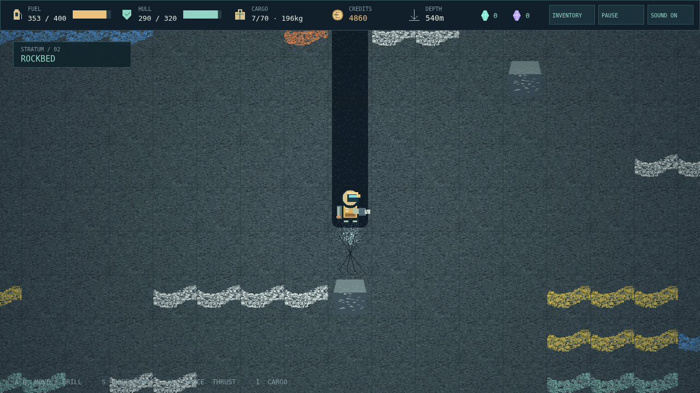

# Deepcore

The dropship is gone. The mine is still here. Strap on a jetpack, brace your drill, and carve a way into a dead planet. Every shaft is yours to cut, and every load of ore is a wager on the climb back.

Follow bright mineral veins through warm topsoil and cold rockbed. Fill the cargo bay, but watch its weight: a handful of deep ore can pin an underpowered jetpack to the floor. Shed the excess, nurse your fuel, and bring the rest home to sell.

The surface camp turns a good haul into another chance. Buy a bigger tank, a stronger drill, a tougher hull, or a scanner for the rare crystals your rocket needs. Bank the expedition at the Save Pad, or choose Hardcore and put the whole run on the line.

Below the rockbed, gas breathes through the walls and lava gathers in the dark. The Core waits beneath it all. Take a Sample and its 90-second countdown starts. Get back, install the ignition, and leave this world behind.

